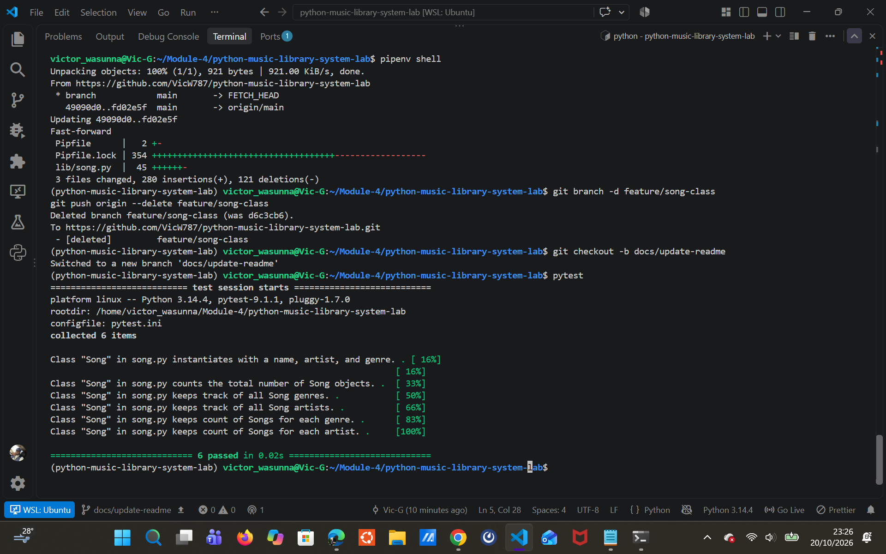

# Python Music Library System

A `Song` class for MusicTech Innovations that represents songs and keeps
track of library-wide information.

## Features
- Create a song with a `name`, `artist` and `genre`
- Track the total number of songs (`Song.count`)
- List all unique genres and artists (`Song.genres`, `Song.artists`)
- Count songs per genre and per artist (`Song.genre_count`, `Song.artists_count`)

## Usage
from lib.song import Song

Song("Halo", "Beyonce", "Pop")

print(Song.count)

## Screenshot
